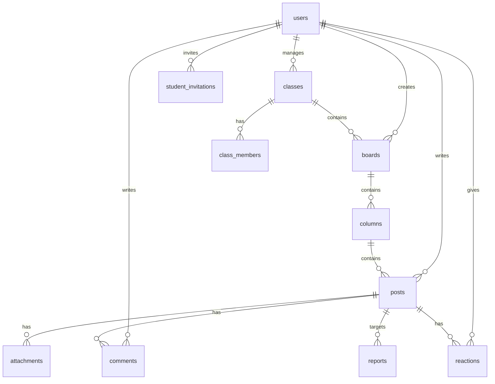

# 데이터베이스 설계서 (DB Specification)

이 문서는 Supabase PostgreSQL에 적용될 전체 테이블 스키마, 관계(FK), 인덱스 및 RLS(Row Level Security) 정책을 정의합니다.

---

## 1. ERD 개요 및 테이블 목록



| 테이블명 | 설명 | 주요 역할 |
|---|---|---|
| `users` | 사용자 프로필 (Supabase `auth.users`와 1:1) | 관리자/교사/학생 구분, 교사 승인 여부 (`approved`) |
| `student_invitations` | 학생 사전 초대 및 매칭 명단 | 관리자/교사가 업로드한 학번, 이름, 이메일 |
| `classes` | 학급 (예: 1학년 3반, 과학 탐구동아리) | 교사가 생성, 학급별 고유 코드 |
| `class_members` | 학급 구성원 매핑 테이블 | 학생이 소속된 학급 정보 |
| `boards` | 패들릿 협업 보드 | 제목, 설명, 레이아웃(wall/shelf/canvas), 잠금, 승인제 옵션 |
| `columns` | 보드 내의 열/구분 (Shelf 레이아웃 등) | 열 제목, 순서(`position`) |
| `posts` | 개별 포스트잇/게시물 | 내용, 색상, 위치(`position_x/y` 또는 `position`), 승인 여부 |
| `attachments` | 게시물 첨부파일 통합 테이블 | 이미지, 일반파일, 웹링크, 유튜브 |
| `comments` | 게시물 댓글 | 내용, 작성자 |
| `reactions` | 게시물 반응 (좋아요 등) | 반응 타입, 유저 ID |
| `reports` | 부적절한 게시물 신고 내역 | 신고 사유, 처리 상태 |
| `audit_logs` | 보안 및 관리 감사 로그 | 작업 내역, 대상 ID, IP/시간 |

---

## 2. 세부 스키마 명세 (PostgreSQL DDL)

```sql
-- 1. ENUM 타입 정의
CREATE TYPE user_role AS ENUM ('admin', 'teacher', 'student');
CREATE TYPE board_layout AS ENUM ('wall', 'shelf', 'canvas');
CREATE TYPE attachment_type AS ENUM ('image', 'file', 'link', 'youtube');
CREATE TYPE report_status AS ENUM ('pending', 'resolved', 'dismissed');

-- 2. 사용자 프로필 테이블
CREATE TABLE public.users (
    id UUID PRIMARY KEY REFERENCES auth.users(id) ON DELETE CASCADE,
    email TEXT NOT NULL UNIQUE,
    full_name TEXT NOT NULL,
    role user_role NOT NULL DEFAULT 'student',
    approved BOOLEAN NOT NULL DEFAULT false, -- 교사인 경우 관리자 승인 필요
    student_number TEXT,                     -- 학생인 경우 학번
    avatar_url TEXT,
    created_at TIMESTAMPTZ NOT NULL DEFAULT timezone('utc'::text, now()),
    updated_at TIMESTAMPTZ NOT NULL DEFAULT timezone('utc'::text, now())
);

-- 3. 학생 사전 초대 명단
CREATE TABLE public.student_invitations (
    id UUID PRIMARY KEY DEFAULT gen_random_uuid(),
    school_code TEXT NOT NULL DEFAULT 'DAESHIN_MS',
    email TEXT NOT NULL UNIQUE,
    full_name TEXT NOT NULL,
    student_number TEXT NOT NULL,
    grade INT,
    class_num INT,
    is_claimed BOOLEAN NOT NULL DEFAULT false,
    claimed_user_id UUID REFERENCES public.users(id),
    created_at TIMESTAMPTZ NOT NULL DEFAULT timezone('utc'::text, now())
);

-- 4. 학급 (Classes)
CREATE TABLE public.classes (
    id UUID PRIMARY KEY DEFAULT gen_random_uuid(),
    name TEXT NOT NULL,                      -- 예: 2학년 4반
    description TEXT,
    teacher_id UUID NOT NULL REFERENCES public.users(id) ON DELETE RESTRICT,
    code TEXT NOT NULL UNIQUE,               -- 학급 초대 코드
    is_archived BOOLEAN NOT NULL DEFAULT false,
    created_at TIMESTAMPTZ NOT NULL DEFAULT timezone('utc'::text, now()),
    updated_at TIMESTAMPTZ NOT NULL DEFAULT timezone('utc'::text, now())
);

-- 5. 학급 멤버십
CREATE TABLE public.class_members (
    id UUID PRIMARY KEY DEFAULT gen_random_uuid(),
    class_id UUID NOT NULL REFERENCES public.classes(id) ON DELETE CASCADE,
    user_id UUID NOT NULL REFERENCES public.users(id) ON DELETE CASCADE,
    joined_at TIMESTAMPTZ NOT NULL DEFAULT timezone('utc'::text, now()),
    UNIQUE(class_id, user_id)
);

-- 6. 보드 (Boards)
CREATE TABLE public.boards (
    id UUID PRIMARY KEY DEFAULT gen_random_uuid(),
    class_id UUID REFERENCES public.classes(id) ON DELETE SET NULL,
    created_by UUID NOT NULL REFERENCES public.users(id) ON DELETE RESTRICT,
    title TEXT NOT NULL,
    description TEXT,
    layout board_layout NOT NULL DEFAULT 'shelf',
    background_color TEXT DEFAULT '#F8FAFC',
    is_locked BOOLEAN NOT NULL DEFAULT false,        -- 읽기 전용 잠금
    require_approval BOOLEAN NOT NULL DEFAULT false, -- 교사 승인 후 게시
    allow_comments BOOLEAN NOT NULL DEFAULT true,    -- 댓글 허용 여부
    allow_reactions BOOLEAN NOT NULL DEFAULT true,   -- 반응(좋아요) 허용 여부
    is_archived BOOLEAN NOT NULL DEFAULT false,
    created_at TIMESTAMPTZ NOT NULL DEFAULT timezone('utc'::text, now()),
    updated_at TIMESTAMPTZ NOT NULL DEFAULT timezone('utc'::text, now())
);

-- 7. 보드 컬럼 (Shelf 레이아웃용)
CREATE TABLE public.columns (
    id UUID PRIMARY KEY DEFAULT gen_random_uuid(),
    board_id UUID NOT NULL REFERENCES public.boards(id) ON DELETE CASCADE,
    title TEXT NOT NULL,
    position DOUBLE PRECISION NOT NULL DEFAULT 1000.0, -- 실수형 중간값 정렬
    created_at TIMESTAMPTZ NOT NULL DEFAULT timezone('utc'::text, now())
);

-- 8. 포스트 (Posts)
CREATE TABLE public.posts (
    id UUID PRIMARY KEY DEFAULT gen_random_uuid(),
    board_id UUID NOT NULL REFERENCES public.boards(id) ON DELETE CASCADE,
    column_id UUID REFERENCES public.columns(id) ON DELETE SET NULL,
    author_id UUID NOT NULL REFERENCES public.users(id) ON DELETE RESTRICT,
    author_name TEXT NOT NULL,
    title TEXT,
    content TEXT NOT NULL DEFAULT '',
    color TEXT DEFAULT '#FFFFFF',
    position DOUBLE PRECISION NOT NULL DEFAULT 1000.0,
    pos_x INT, -- Canvas 레이아웃용
    pos_y INT, -- Canvas 레이아웃용
    is_pinned BOOLEAN NOT NULL DEFAULT false,
    is_approved BOOLEAN NOT NULL DEFAULT true, -- 보드의 require_approval에 따라 false로 생성
    created_at TIMESTAMPTZ NOT NULL DEFAULT timezone('utc'::text, now()),
    updated_at TIMESTAMPTZ NOT NULL DEFAULT timezone('utc'::text, now())
);

-- 9. 첨부파일 통합 (Attachments)
CREATE TABLE public.attachments (
    id UUID PRIMARY KEY DEFAULT gen_random_uuid(),
    post_id UUID NOT NULL REFERENCES public.posts(id) ON DELETE CASCADE,
    type attachment_type NOT NULL,
    url TEXT NOT NULL,
    storage_path TEXT, -- Supabase Storage 내 파일 경로
    file_name TEXT,
    file_size INT,
    mime_type TEXT,
    meta_data JSONB DEFAULT '{}'::jsonb, -- OG 메타태그나 썸네일 정보
    created_at TIMESTAMPTZ NOT NULL DEFAULT timezone('utc'::text, now())
);

-- 10. 댓글 (Comments)
CREATE TABLE public.comments (
    id UUID PRIMARY KEY DEFAULT gen_random_uuid(),
    post_id UUID NOT NULL REFERENCES public.posts(id) ON DELETE CASCADE,
    author_id UUID NOT NULL REFERENCES public.users(id) ON DELETE RESTRICT,
    author_name TEXT NOT NULL,
    content TEXT NOT NULL,
    created_at TIMESTAMPTZ NOT NULL DEFAULT timezone('utc'::text, now())
);

-- 11. 반응 (Reactions)
CREATE TABLE public.reactions (
    id UUID PRIMARY KEY DEFAULT gen_random_uuid(),
    post_id UUID NOT NULL REFERENCES public.posts(id) ON DELETE CASCADE,
    user_id UUID NOT NULL REFERENCES public.users(id) ON DELETE CASCADE,
    reaction_type TEXT NOT NULL DEFAULT 'like',
    created_at TIMESTAMPTZ NOT NULL DEFAULT timezone('utc'::text, now()),
    UNIQUE(post_id, user_id, reaction_type)
);

-- 12. 신고 (Reports)
CREATE TABLE public.reports (
    id UUID PRIMARY KEY DEFAULT gen_random_uuid(),
    post_id UUID NOT NULL REFERENCES public.posts(id) ON DELETE CASCADE,
    reporter_id UUID NOT NULL REFERENCES public.users(id) ON DELETE CASCADE,
    reason TEXT NOT NULL,
    status report_status NOT NULL DEFAULT 'pending',
    created_at TIMESTAMPTZ NOT NULL DEFAULT timezone('utc'::text, now())
);

-- 13. 감사 로그 (Audit Logs)
CREATE TABLE public.audit_logs (
    id UUID PRIMARY KEY DEFAULT gen_random_uuid(),
    actor_id UUID REFERENCES public.users(id) ON DELETE SET NULL,
    action TEXT NOT NULL,
    target_type TEXT NOT NULL,
    target_id TEXT,
    metadata JSONB DEFAULT '{}'::jsonb,
    created_at TIMESTAMPTZ NOT NULL DEFAULT timezone('utc'::text, now())
);
```

---

## 3. RLS(Row Level Security) 핵심 정책 원칙
1. **`users` 테이블**:
   - 누구나 본인 레코드 조회 및 본인 기본 정보 수정 가능.
   - `role` 및 `approved` 필드는 일반 유저가 직접 UPDATE 불가 (오직 `admin` 역할 또는 DB 함수/트리거만 가능).
2. **`boards` 테이블**:
   - 학생은 본인이 소속된 학급의 보드만 조회 가능.
   - 보드 생성/수정/삭제/잠금/승인설정은 오직 `approved = true`인 교사 및 관리자만 가능.
3. **`posts` 테이블**:
   - 보드가 `is_locked = true`인 경우 학생의 INSERT/UPDATE/DELETE 차단.
   - 보드의 `require_approval = true`인 경우, `is_approved = false`인 글은 작성자와 교사/관리자에게만 조회되고 다른 학생에게는 숨김.
   - 학생은 본인이 작성한 글(`author_id = auth.uid()`)만 수정/삭제 가능. 교사는 해당 보드의 모든 글 삭제 및 승인/고정 가능.
4. **`student_invitations` 테이블**:
   - 학생 명단 등록 및 조회는 오직 `teacher`, `admin`만 가능.
